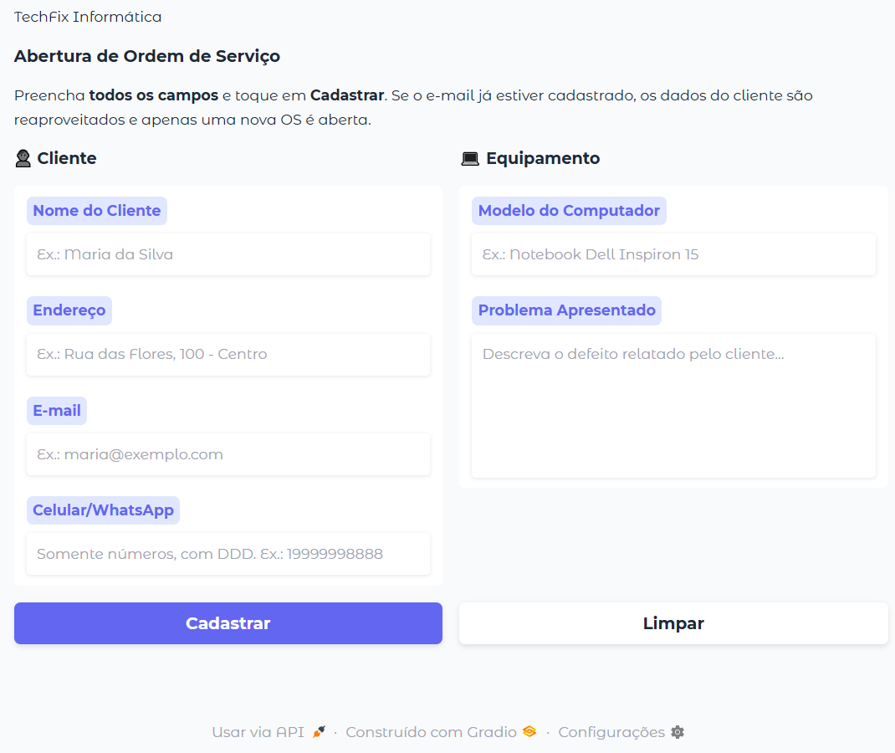
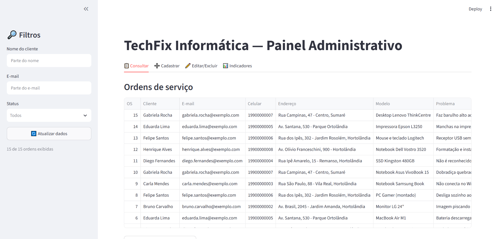
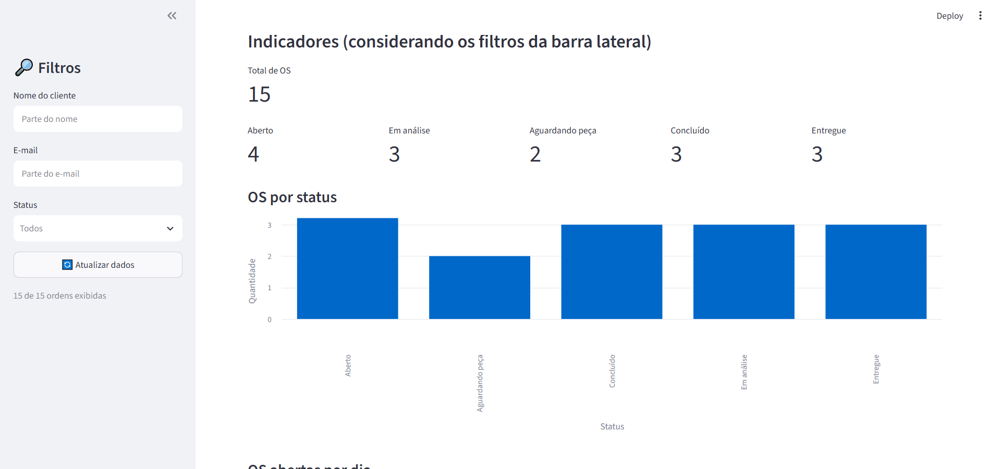

# TechFix Informática — Sistema de Ordens de Serviço

Solução com duas aplicações Python que compartilham um banco PostgreSQL no Supabase:

| Componente | Arquivo | Quem usa | Chave do Supabase |
|---|---|---|---|
| Atendimento (cadastro) | `app_gradio.py` | Atendente, no balcão ou pelo celular | `anon` (só consulta e insere) |
| Painel administrativo (CRUD + indicadores) | `app_streamlit.py` | Gerente / técnico | `service_role` (acesso total) |
| Banco de dados | `sql/schema.sql` | — | — |

```
[Celular / Navegador]                [Navegador do Gerente]
         |                                     |
 App Gradio (cadastro)            App Streamlit (gerenciamento)
         |        supabase-py (API REST)       |
         +-------------> SUPABASE <------------+
                    (PostgreSQL na nuvem)
```

## Estrutura

```
techfix/
├── sql/schema.sql                  # criação do banco (tabelas, CHECKs, FK, índices, trigger, RLS)
├── app_gradio.py                   # interface de cadastro
├── app_streamlit.py                # painel de gerenciamento
├── requirements.txt                # dependências
├── .env.example                    # nomes das variáveis, sem valores
├── .streamlit/secrets.toml.example # alternativa ao .env para o Streamlit
├── .gitignore                      # ignora .env e secrets.toml
├── README.md
└── evidencias/                     # prints da entrega
```

## 1. Banco de dados (Supabase)

1. Crie um projeto gratuito em [supabase.com](https://supabase.com).
2. Abra **SQL Editor**, cole todo o conteúdo de `sql/schema.sql` e clique em **Run**.
3. (Opcional) Descomente o bloco 7 do script para inserir dados fictícios de teste.
4. Em **Project Settings → API**, copie a **Project URL**, a chave **anon** e a chave **service_role**.

O script cria:

- `clientes` — PK, e-mail `UNIQUE`, `NOT NULL` nos campos essenciais, `CHECK` de formato de e-mail e de celular (somente dígitos, 10 a 13 caracteres).
- `ordens_servico` — PK, FK para `clientes` com `ON DELETE CASCADE` (ao excluir um cliente, as OS dele também são excluídas), `CHECK` de status (`Aberto`, `Em análise`, `Aguardando peça`, `Concluído`, `Entregue`).
- Índices em `cliente_id` e `status`, trigger que atualiza `data_atualizacao` automaticamente, e políticas RLS: a chave `anon` só consegue consultar e inserir (OS sempre com status `Aberto`).

## 2. Instalação

Requer Python 3.10+.

```bash
python -m venv .venv
# Windows: .venv\Scripts\activate    |    Linux/macOS: source .venv/bin/activate
pip install -r requirements.txt
```

Configure as credenciais (nunca no código):

```bash
cp .env.example .env        # Windows: copy .env.example .env
```

Preencha o `.env` com a URL e as duas chaves. Para o Streamlit, você também pode usar `.streamlit/secrets.toml` (copie de `secrets.toml.example`); se ele existir, tem prioridade sobre o `.env`.

## 3. Execução

**Atendimento (Gradio):**

```bash
python app_gradio.py
```

Abre em `http://127.0.0.1:7860` e gera um link público temporário (`*.gradio.live`) no terminal — abra esse link no celular para testar.

**Painel (Streamlit):**

```bash
streamlit run app_streamlit.py
```

Abre em `http://localhost:8501`, com as abas:

- **Consultar** — OS com dados do cliente, filtros na barra lateral (nome, e-mail, status) e exportação CSV dos dados filtrados.
- **Cadastrar** — nova OS para cliente existente ou novo.
- **Editar/Excluir** — muda status e dados da OS, edita dados do cliente e exclui OS ou cliente com confirmação.
- **Indicadores** — métricas por status, gráfico de barras e OS abertas por dia.

## 4. Segurança e boas práticas

- Credenciais apenas em `.env` / `secrets.toml`, ambos no `.gitignore`.
- A chave `service_role` é usada só no painel do gerente; o app do balcão usa a `anon`, limitada pelo RLS.
- Validação nos apps **e** no banco (`CHECK`), e todas as operações com o banco estão em `try/except` com mensagens amigáveis.
- Use apenas dados fictícios nos testes (LGPD).

## Telas

**Cadastro de OS (Gradio)**


**Painel administrativo (Streamlit)**

